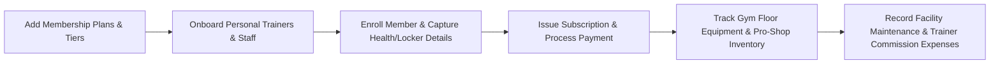
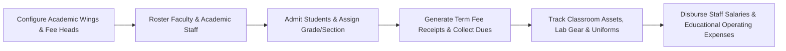
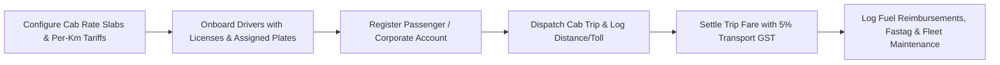
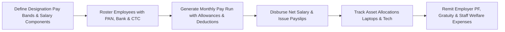
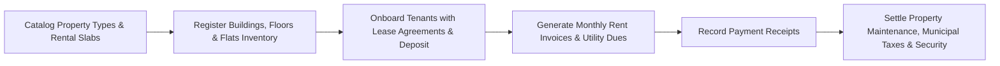
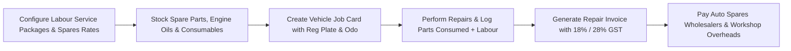
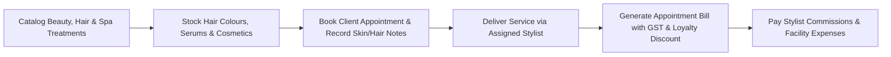
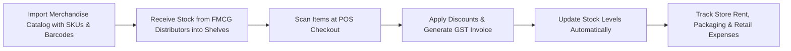
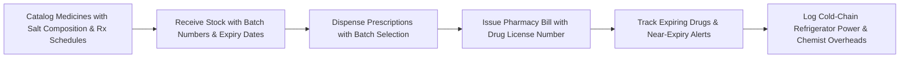
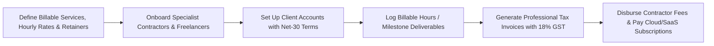

# Exdrow Business Operating System: Templates, Tables & Business Flows Specification

## 1. Executive Summary & Architecture Overview

Exdrow is an offline-first, Excel-native business management desktop application designed for small and medium businesses (SMBs). Every business edition operates on a unified relational schema saved directly as an Excel workbook (`.xlsx`), backed by an ultra-fast in-memory and Rust-accelerated workbook engine.

### The 8 Core Relational Tables
Every business edition is structured around 8 interconnected tables with dedicated business terminology, column definitions, and workflow integration:

1. **`_Products`**: The core catalog of what the business offers (Goods, Services, Membership Plans, Room Tariffs, Medical Procedures, Menu Dishes, Rate Slabs, or Pay Scales).
2. **`_Inventory`**: Physical stock, assets, capacity, batch lots, or fleet status associated with operations.
3. **`_Customers`**: The demand side — buyers, clients, patients, students, members, guests, passengers, tenants, or employees.
4. **`_Suppliers`**: The supply & staff side — vendors, wholesale partners, instructors, doctors, trainers, drivers, technicians, or contractors.
5. **`_Sales`**: Primary commercial transaction ledger — invoices, receipts, bills, folios, KOT orders, trips, or salary pay runs.
6. **`_SaleItems`**: Itemized transaction breakdown mapping line-items to catalog offerings with quantities, rates, taxes, and discounts.
7. **`_Expenses`**: Outgoing operational expenditure ledger — rent, utilities, maintenance, consumables, vendor payouts, and payroll overhead.
8. **`_Categories`**: Classification hierarchy grouping products, services, wings, or departments.

---

## 2. Comprehensive Business Editions Directory

| # | Business Edition | Flow Key | Core Commercial Object | Inventory / Resource Unit | Client / Recipient Entity | Provider / Staff Entity |
|---|------------------|----------|------------------------|---------------------------|---------------------------|-------------------------|
| 1 | **Gym & Fitness Center** | `gym` | Membership Plans & Passes | Equipment & Pro-Shop Goods | Gym Members | Personal Trainers & Coaches |
| 2 | **School & Academy** | `school` | Academic Fee Heads & Slabs | Classroom & Lab Assets | Students (Roster) | Teachers & Faculty |
| 3 | **Restaurant & Cafe** | `restaurant` | Menu Dishes & Recipes | Kitchen Raw Ingredients | Dine-in Guests & Tables | Kitchen Vendors & Dairies |
| 4 | **Hotel & Hospitality** | `hotel` | Room Categories & Tariffs | Room Units & Housekeeping | Hotel Guests & Folios | Laundry & F&B Vendors |
| 5 | **Hospital & Clinic** | `hospital` | Procedures & OPD Consultations | Hospital Beds & Medical Supplies | Patients Registry | Doctors & Specialists |
| 6 | **Taxi & Fleet Logistics** | `taxi` | Cab Rates & Fare Slabs | Active Fleet Cabs & Status | Passengers & Corporate Clients | Fleet Drivers & Cab Owners |
| 7 | **Coaching Institute** | `coaching` | Course Batches & Programs | Study Material Kits & Booklets | Enrolled Students | Faculty & Subject Mentors |
| 8 | **Company Payroll** | `payroll` | Salary Bands & Pay Structures | Allowances & Perks Pool | Employees Roster | HR Contractors & Auditors |
| 9 | **Real Estate & Rental** | `realestate` | Property Units & Rental Slabs | Flats, Shops & Units Registry | Tenants & Leaseholders | Maintenance Contractors |
| 10 | **Auto Garage & Workshop** | `garage` | Repair Services & Labour Slabs | Spare Parts & Fluids Stock | Vehicle Owners (Job Cards) | Spares Wholesalers |
| 11 | **Salon & Wellness Spa** | `salon` | Beauty & Hair Treatments | Cosmetics & Consumable Stock | Salon Clients | Stylists & Product Brands |
| 12 | **Retail POS** | `retail` | Retail Goods & Merchandise | Shelf Stock & Storeroom Bins | Retail Shoppers | FMCG Distributors |
| 13 | **Wholesale B2B** | `wholesale` | Bulk Case Packs & Master Cartons | Warehouse Pallet Bins | B2B Dealers & Retailers | Manufacturing Mills |
| 14 | **Pharmacy & Chemist** | `pharmacy` | Medicines & Generic Formulations | Batch Lots & Expiry Tracker | Patients & Regular Buyers | Pharma Stockists & C&F Agents |
| 15 | **Professional Services** | `services` | Billable Services & Retainers | Available Hours & Bench Capacity | Client Companies | Contractors & Freelancers |
| 16 | **Manufacturing & Assembly** | `manufacturing` | Finished Goods (BOM Assemblies) | Raw Materials & Component Stock | B2B Buyers & Distributors | Material & Hardware Vendors |

---

## 3. Detailed Business Flows & Table Specifications

---

### 3.1 Gym & Fitness Center (`gym`)

#### Business Flow

1. **Catalog Setup**: Define membership tiers (Monthly, Quarterly Gold, Annual Platinum, Personal Training Bundles).
2. **Trainer Onboarding**: Register certified trainers, their specialties (Strength, Crossfit, Yoga), and commission splits.
3. **Member Enrollment**: Capture member contact, emergency contact, assigned locker, health goals, and membership validity.
4. **Subscription Billing**: Issue subscription invoices with GST (18%), discount promotions, and payment channels (UPI, Card, Cash).
5. **Gym Floor Operations**: Track pro-shop supplements (Whey, Shakers) and gym asset condition (Treadmills, Dumbbells, Lockers).
6. **Expense Tracking**: Log rent, electricity/HVAC, equipment maintenance AMC, music license, and trainer payouts.

#### Table Schemas & Data

* **`_Products` (Membership Plans & Passes)**
  * `product_id`: Unique Plan Code (`PLAN_GOLD_3M`, `PLAN_PLAT_12M`, `PLAN_DROPIN`)
  * `sku`: Tier Code (`GOLD-3M`, `PLAT-1Y`, `DAY-PASS`)
  * `name`: Plan Name (`Gold 3-Month Access`, `Platinum Annual All-Access`, `Single Day Drop-In Pass`)
  * `category_id`: Tier Category Reference (`Quarterly Tier`, `Annual Tier`, `Daily Passes`)
  * `purchase_price`: Base Overhead / Maintenance Cost
  * `selling_price`: Membership Fee
  * `gst_rate`: GST % (18%)
  * `unit`: Duration Unit (`3 Months`, `12 Months`, `1 Day`)
  * `minimum_stock`: Target Active Members
  * `status`: Plan Status (`active`, `inactive`)

* **`_Inventory` (Gym Equipment & Pro-Shop Stock)**
  * `inventory_id`: Stock / Locker ID (`EQP_TREAD_01`, `EQP_DUMB_SET`, `SUPP_WHEY_2KG`, `LOCKER_BAY_A`)
  * `product_id`: Linked Product / Category Code
  * `quantity`: Units Available / Quantity in Stock
  * `minimum_stock`: Reorder / Maintenance Threshold
  * `updated_at`: Last Audit / Service Check Date

* **`_Customers` (Gym Members Directory)**
  * `customer_id`: Member ID (`MEM_2026_101`)
  * `name`: Member Full Name
  * `phone`: Contact WhatsApp / Mobile
  * `email`: Email Address
  * `address`: Assigned Locker # & Preferred Trainer
  * `gstin`: Emergency Contact Phone & Blood Group
  * `created_at`: Join Date
  * `updated_at`: Membership Valid Till Date

* **`_Suppliers` (Personal Trainers & Staff)**
  * `supplier_id`: Trainer ID (`TRN_01`)
  * `name`: Trainer Full Name
  * `phone`: Mobile #
  * `email`: Email
  * `address`: Specialization & Shift (`Hypertrophy & Conditioning • Morning Shift`)
  * `gstin`: Certification ID (`ACE-CPT-98210`)
  * `notes`: Payout Terms (`60% Commission on Personal Training`)
  * `created_at`: Joining Date

* **`_Sales` (Subscriptions & Renewals)**
  * `sale_id`: Subscription Invoice # (`SUB-2026-001`)
  * `customer_id`: Member Name / ID
  * `sale_date`: Activation Date
  * `subtotal`: Plan Base Amount
  * `discount`: Concession / Promo Code
  * `tax`: 18% GST Amount
  * `total`: Grand Total Paid
  * `payment_method`: Payment Channel (`UPI / QR`, `Credit Card`, `Cash`)
  * `status`: Subscription Status (`active`, `expired`, `pending`)

* **`_SaleItems`**: Line items for Plan Duration, Locker Rental Addon, Trainer Addon.
* **`_Expenses`**: Equipment repair, Facility rent, Electric HVAC bill, Protein supplement wholesale restocking.
* **`_Categories`**: Duration Tiers (`Monthly`, `Quarterly`, `Annual`, `Personal Training`).

---

### 3.2 School & Academy (`school`)

#### Business Flow

1. **Academic Setup**: Set grade wings (Pre-Primary, Primary, Middle, Secondary, Senior Secondary) and fee heads (Tuition, Lab, Transport, Library).
2. **Faculty Roster**: Maintain teacher records with subject departments and employee codes.
3. **Student Admission**: Register students with Roll Numbers, Grade & Section, Guardian details, and Transport routes.
4. **Fee Collection**: Issue quarterly/term tuition receipts, apply sibling discounts, record bank netbanking or cheque numbers.
5. **Campus Assets**: Track science lab equipment, computer lab terminals, library sets, and bus fleet capacity.
6. **Institutional Expenses**: Manage teacher payouts, laboratory chemicals, examination printing, and campus maintenance.

#### Table Schemas & Data

* **`_Products` (Academic Fee Heads & Slabs)**
  * `product_id`: Fee Head ID (`FEE_T1_TUIT_PRI`, `FEE_LAB_STEM`, `FEE_BUS_R1`)
  * `sku`: Fee Code (`TUIT-T1`, `LAB-SCI`, `BUS-R1`)
  * `name`: Fee Description (`Primary Tuition (Term 1)`, `Robotics & STEM Lab Fee`, `School Bus Transport Route #1`)
  * `category_id`: Grade Wing (`Primary Wing`, `Middle Wing`, `Senior Secondary`)
  * `purchase_price`: Direct Cost to School
  * `selling_price`: Term Fee Amount
  * `gst_rate`: 0% (Education GST Exempt)
  * `unit`: Billing Frequency (`Term`, `Annual`, `Monthly`)
  * `minimum_stock`: Target Student Enrollment
  * `status`: Status (`active`)

* **`_Inventory` (Classroom, Lab & Transport Assets)**
  * `inventory_id`: Asset Code (`LAB_MICROSCOPE_SET`, `IT_COMP_LAB_01`, `BUS_VAN_04`, `UNIFORM_KIT_M`)
  * `product_id`: Associated Department / Fee Head
  * `quantity`: Working Units / Capacity Available
  * `minimum_stock`: Minimum Required Threshold
  * `updated_at`: Last Verification Date

* **`_Customers` (Students Roster)**
  * `customer_id`: Student ID (`STU_2026_001`)
  * `name`: Student Full Name
  * `phone`: Guardian Primary Mobile
  * `email`: Parent Communication Email
  * `address`: Grade & Section (`Grade 9 - Section B`)
  * `gstin`: Admission / Roll No (`ADM-2026-0921`)
  * `created_at`: Admission Date
  * `updated_at`: Current Academic Year

* **`_Suppliers` (Teachers & Faculty)**
  * `supplier_id`: Teacher Code (`TCH_101`)
  * `name`: Faculty Full Name
  * `phone`: Contact Phone
  * `email`: Official School Email
  * `address`: Subject & Department (`Mathematics - HOD`)
  * `gstin`: Employee Staff Code (`EMP-FAC-012`)
  * `notes`: Qualification & Class Mentor Role
  * `created_at`: Joining Date

* **`_Sales` (Fee Receipts Ledger)**
  * `sale_id`: Fee Receipt # (`REC-2026-001`)
  * `customer_id`: Student Name / ID
  * `sale_date`: Receipt Collection Date
  * `subtotal`: Tuition & Facility Charges
  * `discount`: Sibling / Merit Concession
  * `tax`: 0 (Exempt)
  * `total`: Total Amount Paid
  * `payment_method`: Mode (`NetBanking`, `Cheque`, `UPI`)
  * `status`: Receipt Status (`paid`, `partial`, `due`)

* **`_SaleItems`**: Fee items included in the receipt (Tuition, Computer Lab, Bus).
* **`_Expenses`**: Chemistry glassware renewal, Sports day uniforms, Campus whitewash & maintenance, Library books subscription.
* **`_Categories`**: Academic Wings (`Pre-Primary`, `Primary & Middle`, `Secondary`, `Senior Secondary`).

---

### 3.3 Restaurant, Cafe & Cloud Kitchen (`restaurant`)

#### Business Flow

1. **Menu Management**: Configure dishes by category (Starters, Mains, Desserts, Beverages) with raw food costs and selling prices.
2. **Vendor Sourcing**: Onboard fresh dairy, meat, poultry, vegetable mandi, and dry pantry wholesalers.
3. **Daily Prep & Stock**: Track raw materials (Paneer, Basmati Rice, Chicken, Butter, Coffee beans) and daily prep portions.
4. **Kitchen Order Ticketing (KOT)**: Take table orders with dietary notes (Spice level, Jain, Vegan, Extra cheese).
5. **Bill Settlement**: Generate final guest bill with 5% restaurant GST, happy hour discounts, and split payment options.
6. **Operational Cost Control**: Track commercial LPG refills, daily vegetable cash receipts, chef uniforms, and packaging boxes.

#### Table Schemas & Data

* **`_Products` (Dishes & Menu Catalog)**
  * `product_id`: Dish Code (`DISH_PANEER_TIKKA`, `DISH_BIRYANI_DUM`, `DISH_COLD_BREW`, `DISH_BROWNIE_SIZZLER`)
  * `sku`: Kitchen SKU (`APP-PTIKKA`, `MAIN-HYD-DUM`, `BEV-C-BREW`, `DES-SIZZ-BRW`)
  * `name`: Dish Name (`Tandoori Paneer Tikka (Chef Special)`, `Hyderabadi Dum Biryani`, `Artisanal Cold Brew Coffee`, `Sizzling Brownie with Ice Cream`)
  * `category_id`: Kitchen Course (`Starters & Appetizers`, `Main Course & Rice`, `Beverages & Bar`, `Desserts`)
  * `purchase_price`: Food Cost (Raw Materials)
  * `selling_price`: Menu Selling Price
  * `gst_rate`: 5% Restaurant GST
  * `unit`: Serving Unit (`plate (6 pcs)`, `handi portion`, `glass (300ml)`, `portion`)
  * `minimum_stock`: Daily Prep Target Portions
  * `status`: Kitchen Status (`active`, `out_of_stock`)

* **`_Inventory` (Raw Ingredients & Bar Prep Stock)**
  * `inventory_id`: Stock Item ID (`RAW_PANEER_KG`, `RAW_BASMATI_RICE`, `RAW_COFFEE_BEANS`, `RAW_PACKING_BOX`)
  * `product_id`: Linked Menu Item / Category
  * `quantity`: Stock On-hand (kg, litres, packets)
  * `minimum_stock`: Reorder Alert Level
  * `updated_at`: Last Kitchen Count Time

* **`_Customers` (Dine-in Guests & Delivery Orders)**
  * `customer_id`: Guest / Table ID (`TBL_04_GUEST`, `SWIGGY_ORDER_01`, `VIP_GUEST_12`)
  * `name`: Guest Full Name / Channel Name
  * `phone`: Mobile Contact
  * `email`: Email Address
  * `address`: Table # / Delivery Destination (`Table #04 (Indoor AC)`)
  * `gstin`: Special Dietary Notes & Preferences (`Prefers Medium Spicy, Extra Lemon`)
  * `created_at`: Visit Date
  * `updated_at`: Last Order Time

* **`_Suppliers` (Kitchen Vendors & Provisioners)**
  * `supplier_id`: Vendor ID (`VND_DAIRY_01`, `VND_VEG_MANDI`, `VND_POULTRY_01`)
  * `name`: Vendor Enterprise (`Motherland Dairy Fresh`, `City Mandi Wholesalers`, `Apex Poultry & Meats`)
  * `phone`: Contact Phone
  * `email`: Vendor Email
  * `address`: Supply Category (`Fresh Dairy, Paneer & Butter`)
  * `gstin`: Vendor GSTIN
  * `notes`: Delivery Schedule & Payment Terms (`Daily 06:00 AM Delivery • Weekly Settlement`)
  * `created_at`: Onboarded Date

* **`_Sales` (KOT & Table Orders Ledger)**
  * `sale_id`: Order / KOT Bill # (`KOT-2026-104`)
  * `customer_id`: Guest Name / Table #
  * `sale_date`: Order Timestamp
  * `subtotal`: Food Subtotal
  * `discount`: Promotional Concession
  * `tax`: 5% Restaurant GST
  * `total`: Final Bill Amount
  * `payment_method`: Settlement Mode (`UPI / QR`, `Credit Card`, `Cash`)
  * `status`: Order Status (`served`, `billed`, `cancelled`)

* **`_SaleItems`**: Ordered dishes, quantities, dish prices, line totals.
* **`_Expenses`**: Commercial LPG cylinders, Morning mandi cash purchase, Kitchen equipment servicing, Swiggy packaging bags.
* **`_Categories`**: Menu Departments (`Starters & Appetizers`, `Main Course & Rice`, `Beverages & Bar`, `Desserts`).

---

### 3.4 Hotel, Resort & Hospitality (`hotel`)

#### Business Flow

1. **Catalog**: Set room categories (Deluxe King, Executive Suite, Pool Villa) with seasonal nightly tariffs and 12% GST.
2. **Suppliers**: Partner with laundry/linen providers, room amenities suppliers, and food distributors.
3. **Guest Check-in**: Collect guest contact, passport/Govt ID proof, nationality, and assign room.
4. **Stay Folio Billing**: Accumulate room nights, dining room service, laundry addons, and calculate total stay invoice.
5. **Housekeeping Inventory**: Track room occupancy status (Vacant Clean, Occupied, Dirty, Under Maintenance) and linen kits.
6. **Operating Expenses**: Pay commercial laundry bills, toiletries restocking, power generator diesel, and OTA commissions.

#### Key Table Highlights
* `_Products`: Room Types (`ROOM_DELUXE`, `ROOM_SUITE`, `ROOM_VILLA`) with unit `night` and tariff rates.
* `_Inventory`: Physical Rooms (`ROOM_101`, `ROOM_201`, `ROOM_301`) with housekeeping check timestamps.
* `_Customers`: Hotel Guests with Passport / Aadhaar numbers, nationality, and contact info.
* `_Suppliers`: Commercial Linen Laundries, F&B Provisioners, Maintenance contractors.
* `_Sales`: Stay Folios (`FOLIO-2026-081`) with check-in/out dates, room charges, and 12% GST.

---

### 3.5 Hospital, Clinic & Healthcare (`hospital`)

#### Business Flow

1. **Medical Catalog**: Define General OPD, Specialist Consultations, Diagnostic Tests (CBC, X-Ray), and Bed Charges.
2. **Doctors Directory**: Manage visiting consultants, department specialties (Cardiology, Ortho, Pediatrics), and consultation fee splits.
3. **Patient Registry**: Register patients with unique UHIDs, age, gender, blood group, emergency contact, and medical history/allergies.
4. **Billing & Encounters**: Generate OPD receipts or IPD bills with procedure codes and medicine charges.
5. **Bed & Supplies Inventory**: Monitor ICU and ward bed status, oxygen cylinder reserves, and disposable medical kits.
6. **Healthcare Expenses**: Record bio-waste disposal fees, diagnostic machinery AMC, nurse overtime, and doctor honorarium payouts.

#### Key Table Highlights
* `_Products`: Procedures (`MED_OPD_GEN`, `MED_CARDIO_CONS`, `MED_LAB_CBC`, `MED_BED_DELUXE`).
* `_Inventory`: Hospital Bed Registry & Emergency Consumables (`BED_ICU_01`, `BED_WARD_A10`, `SUPP_O2_CYLINDER`).
* `_Customers`: Patient Registry (`PAT_UHID_9012`) with Age, Blood Group, Guardian, Allergies.
* `_Suppliers`: Consulting Doctors & Medical Surgeons (`DR_KAPOOR_CARDIO`).
* `_Sales`: Encounter Bills (`MED-ENC-2026-042`) with doctor name, procedure lines, and settlement mode.

---

### 3.6 Taxi & Cab Fleet Logistics (`taxi`)

#### Business Flow

1. **Fare Catalog**: Define City Sedan base, Outstation SUV per-km, Airport Flat rates, and 5% transport GST.
2. **Driver Fleet**: Maintain driver profiles with commercial driving licenses, assigned plate numbers, and commission percentages.
3. **Passenger Booking**: Register passengers and corporate GSTIN billing accounts with default pickup locations.
4. **Trip Billing**: Compute distance km × per-km rate + toll charges into final trip invoice.
5. **Fleet Inventory**: Track active cabs on duty, standby fleet target, and fitness inspection dates.
6. **Operating Expenses**: Manage driver fuel disbursements, Fastag toll recharges, tire changes, and insurance renewals.

#### Key Table Highlights
* `_Products`: Cab Slabs (`SLAB_SEDAN_CITY`, `SLAB_SUV_OUTSTN`, `SLAB_AIRPORT_FLAT`).
* `_Inventory`: Vehicle Registration Numbers (`CAB_KA01_AB_1234`, `CAB_DL01_XY_9876`).
* `_Customers`: Passengers & Corporate Enterprise Accounts (`Mr. Rajesh Sharma`, `Infosys Corporate`).
* `_Suppliers`: Fleet Drivers (`Driver Ramesh Kumar`, `Driver Gurpreet Singh`).
* `_Sales`: Trip Dispatches (`TRIP-2026-1001`) with pickup, destination, km logged, and fare collected.

---

### 3.7 Coaching Institute & Tuition (`coaching`)

#### Business Flow

1. **Course Catalog**: Define target exams (IIT-JEE, NEET, Foundation Grade 10) with course fees and installment plans.
2. **Faculty Registry**: Onboard teachers with subject specializations (Physics, Organic Chemistry, Mathematics).
3. **Student Enrollment**: Capture student target exam, parent contact, enrolled batch, and scholarship concessions.
4. **Installment Billing**: Collect fee installments (1 of 3, 2 of 3), track dues, and issue official receipts.
5. **Study Kit Inventory**: Manage printed question banks, test series booklets, and bag sets.
6. **Operating Expenses**: Faculty lecture fees, study material printing & binding, center lease rent, and online portal servers.

#### Key Table Highlights
* `_Products`: Courses & Batches (`CRS_JEE_2YR`, `CRS_NEET_1YR`, `CRS_FOUND_10`).
* `_Inventory`: Study Material Sets (`KIT_JEE_PHY_VOL1`, `KIT_NEET_BIO_MOCK`).
* `_Customers`: Enrolled Students with Parent Mobile, Target Exam, Roll #.
* `_Suppliers`: Subject Instructors (`Prof. H. C. Verma Mentors`).
* `_Sales`: Installment Fee Receipts (`COACH-REC-2026-081`).

---

### 3.8 Company Payroll & HR (`payroll`)

#### Business Flow

1. **Pay Structures**: Establish salary slabs by designation (Software Engineer L2, Senior Lead, Operations Executive).
2. **Employee Roster**: Archive employee personal details, PAN, bank account numbers, IFSC codes, and joining dates.
3. **Monthly Pay Run**: Compute Basic Pay, HRA, Special Allowance, PF deduction, and Professional Tax.
4. **Payslip Delivery**: Generate official monthly payslips with net salary disbursements.
5. **Asset Inventory**: Track allocated company laptops, access cards, and monitors.
6. **Payroll Expenses**: Remit corporate PF share, team welfare, employee medical insurance, and compliance audits.

#### Key Table Highlights
* `_Products`: Salary Structures (`SAL_BAND_SWE2`, `SAL_BAND_LEAD`, `SAL_BAND_OPS`).
* `_Inventory`: Company Equipment & Laptop Pool (`AST_MACBOOK_M3_01`, `AST_DELL_LAT_04`).
* `_Customers`: Employees Directory (`EMP_2026_042` - `Rohan Verma`, `Software Engineer`).
* `_Suppliers`: HR Auditors & External Background Verification Agencies.
* `_Sales`: Monthly Payslip Records (`PAYSLIP-2026-08-042`).

---

### 3.9 Real Estate & Rental Property (`realestate`)

#### Business Flow

1. **Property Catalog**: Define rental categories (2BHK Premium, Commercial Retail Shop, 3BHK Penthouse).
2. **Units Registry**: Track each physical unit/flat number, floor, square footage, and occupancy status.
3. **Tenant Onboarding**: Register tenant personal details, lease start/end dates, and security deposit amounts.
4. **Rent Collection**: Issue monthly rent invoices including base rent, society maintenance, and water/electricity charges.
5. **Maintenance & Contractors**: Onboard plumbers, electricians, painters, and elevator AMC vendors.
6. **Property Expenses**: Pay municipal property taxes, common electricity bills, security guard wages, and building repairs.

#### Key Table Highlights
* `_Products`: Unit Tariffs (`PROP_2BHK_PREM`, `PROP_3BHK_LUX`, `PROP_COMM_SHOP`).
* `_Inventory`: Flats & Units (`FLAT_101_T1`, `FLAT_204_T2`, `SHOP_G02`).
* `_Customers`: Tenants (`Mr. Sandeep Menon`, `Lease till Dec 2027`).
* `_Suppliers`: Maintenance Technicians & Facility Contractors.
* `_Sales`: Rent Collection Invoices (`RENT-2026-AUG-101`).

---

### 3.10 Auto Garage & Workshop (`garage`)

#### Business Flow

1. **Service Catalog**: Define repair labour packages (General Periodic Service, Wheel Alignment, AC Gas Refill, Brake Pad Overhaul).
2. **Spare Parts Inventory**: Maintain bin stock of engine oils (5W-30), oil filters, brake pads, spark plugs, and wiper blades.
3. **Job Card Creation**: Log customer name, vehicle plate number (e.g. `MH02-CR-4567`), make & model, and odometer reading.
4. **Repair Invoicing**: Combine labour operations and replacement spare parts into a single tax invoice.
5. **Parts Wholesalers**: Connect with authorized distributor partners (Bosch, Castrol, Mobil, Brembo).
6. **Garage Expenses**: Workshop rent, hydraulic lift maintenance, tool wear-and-tear, waste oil disposal fees, and mechanic wages.

#### Key Table Highlights
* `_Products`: Repair Labour Packages (`SRV_GEN_PERIODIC`, `SRV_WHEEL_ALIGN`, `SRV_BRAKE_PADS`).
* `_Inventory`: Spares & Oils Stock (`PART_OIL_5W30_SYN`, `PART_FILTER_OIL_HND`, `PART_BRAKE_PAD_SET`).
* `_Customers`: Vehicle Owners & Job Cards (`Rahul Mehra`, `Hyundai Creta MH02-CR-4567`).
* `_Suppliers`: Auto Spares Wholesalers (`Apex Auto Spares Wholesale`).
* `_Sales`: Repair Invoices (`JOB-2026-892`).

---

### 3.11 Salon, Spa & Wellness (`salon`)

#### Business Flow

1. **Service Menu**: Catalog hair rituals (Keratin, Balayage), skin facials (Hydra Facial), massages, and grooming services.
2. **Salon Inventory**: Track professional cosmetics (L'Oreal Inoa color tubes, Moroccanoil, single-use facial kits).
3. **Client Profile**: Note client preferences, preferred stylists, allergies/sensitivities, and membership tiers.
4. **Billing**: Invoice completed appointments with service fees, product retail sales, stylist tags, and GST (18%).
5. **Beauty Vendors**: Onboard professional cosmetic suppliers and disposable linen distributors.
6. **Salon Expenses**: Stylist commissions, freshly laundered towels, premium coffee bar, and salon interior utilities.

#### Key Table Highlights
* `_Products`: Treatments (`TRT_KERATIN_SMOOTH`, `TRT_HYDRA_FACIAL`, `TRT_HAIRCUT_STYL`).
* `_Inventory`: Color Tubes, Serums & Retail Bottles (`COS_INOA_TUBE_5N`, `COS_MOROCCAN_OIL`).
* `_Customers`: Salon Clients (`Ananya Sen`, `Prefers Stylist Dev • Sensitive Scalp`).
* `_Suppliers`: Cosmetics Brands & Wholesalers (`L'Oreal Professional Distribution`).
* `_Sales`: Salon Bills (`SALON-2026-4401`).

---

### 3.12 Retail Point of Sale (`retail`)

#### Business Flow

1. **Product Catalog**: Maintain retail merchandise with barcodes, SKUs, MRPs, cost prices, and GST brackets (5%, 12%, 18%).
2. **Storefront Inventory**: Manage shelf locations, quantities on hand, and automated minimum stock reorder alerts.
3. **Customer Accounts**: Register walk-in and loyalty customers with mobile numbers and accumulated points.
4. **POS Billing**: Rapid item lookup/scanning, discount computation, multi-mode payment, and thermal/A4 receipt printing.
5. **Distributors**: Manage FMCG distributors with payment credit days and purchase orders.
6. **Retail Expenses**: Store rent, shopping bag packaging, POS terminal swipe fees, and utility bills.

#### Key Table Highlights
* `_Products`: Retail Items (`PROD_EARBUDS_PRO`, `PROD_POWERBANK_20K`, `PROD_SMART_WATCH`).
* `_Inventory`: Shelf Bins (`BIN_A1_AUDIO`, `BIN_B3_POWER`).
* `_Customers`: Retail Buyers (`Vikram Patel`).
* `_Suppliers`: Electronics & FMCG Wholesalers (`Apex Consumer Electronics Dist`).
* `_Sales`: POS Invoices (`INV-2026-001`).

---

### 3.13 Wholesale & B2B Distribution (`wholesale`)

#### Business Flow

1. **Bulk Products**: Define master case packs, carton quantities, factory cost, dealer wholesale pricing, and MOQ.
2. **Warehouse Storage**: Track warehouse bays, pallets, carton balances, and batch lot numbers.
3. **Dealer Accounts**: Manage B2B retailers with verified enterprise GSTINs, godown delivery addresses, and credit limits.
4. **Wholesale Invoicing**: Generate B2B tax invoices with trade discounts, GST breakdowns, and transporter Lorry Receipts (LR #).
5. **Mills & Importers**: Direct supplier integration with manufacturing mills and primary importers.
6. **Wholesale Expenses**: Warehouse godown leases, loading/unloading labour wages, forklift fuel, and freight carriage outwards.

#### Key Table Highlights
* `_Products`: Wholesale Case SKUs (`CASE_LED_BULB_50`, `CASE_COPPER_WIRE_10`).
* `_Inventory`: Warehouse Pallets (`PALLET_BAY_04`, `PALLET_BAY_12`).
* `_Customers`: B2B Retail Enterprises (`Shree Krishna Electricals & Retail`).
* `_Suppliers`: Manufacturing Mills (`National Copper Works Ltd`).
* `_Sales`: B2B Invoices (`WH-INV-2026-102`).

---

### 3.14 Pharmacy & Healthcare Chemist (`pharmacy`)

#### Business Flow

1. **Drug Catalog**: Maintain pharmaceutical medicines with salt compositions, formulation types (Tablet, Syrup, Injection), and Schedule H flags.
2. **Batch & Expiry Tracker**: Crucial tracking of Batch Numbers, Manufacturing Dates, Expiry Dates, and shelf rack locations.
3. **Patient Registry**: Record patient details, prescribing doctors, chronic condition tags, and prescription history.
4. **Rx Dispensing**: Dispense exact batches, calculate strip/unit prices with 5%/12% GST, and verify prescription compliance.
5. **Pharma Distributors**: Partner with licensed pharmaceutical distributors holding valid 20B/21B drug licenses.
6. **Pharmacy Expenses**: Refrigerator/cold-chain electricity backup, disposal of expired medicines, and pharmacy software licenses.

#### Key Table Highlights
* `_Products`: Medicines (`DRUG_AUGMENTIN_625`, `DRUG_PANTOCID_40`, `DRUG_AZITHRAL_500`).
* `_Inventory`: Batch Lots (`BATCH_AUG_9821_EXP2027`, `BATCH_PAN_4401_EXP2026`).
* `_Customers`: Patients (`Mrs. Sharda Devi`, `Dr. Rao Clinic Ref`).
* `_Suppliers`: C&F Stockists (`LifeCare Pharmaceuticals Wholesale DL-20B`).
* `_Sales`: Rx Dispensing Bills (`RX-2026-9041`).

---

### 3.15 Professional Services & Consulting (`services`)

#### Business Flow

1. **Service Catalog**: Define service lines (Architecture Design, Legal Advisory, Software Engineering, Marketing Retainer) with hourly/milestone rates.
2. **Resource Capacity**: Track committed client retainer hours, deliverable progress, and bench availability.
3. **Client Accounts**: Maintain corporate enterprise clients with billing addresses, corporate GSTINs, and Net-30 payment terms.
4. **Milestone Invoicing**: Issue professional tax invoices for completed milestones or monthly retainers with 18% GST.
5. **Contractor Subcontracting**: Track specialist subcontractors, freelancers, and payout agreements.
6. **Practice Expenses**: Cloud infrastructure (AWS/GCP), SaaS tools (Figma, GitHub), client dinners, and legal compliance.

#### Key Table Highlights
* `_Products`: Services (`SRV_CLOUD_ARCH`, `SRV_UX_AUDIT`, `SRV_MONTHLY_RETAINER`).
* `_Inventory`: Deliverables Pool (`DELIV_AWS_MIGRATION`, `DELIV_DESIGN_SYSTEM`).
* `_Customers`: Corporate Clients (`Nexus FinTech Labs Inc`).
* `_Suppliers`: Subcontractors (`Alex Rivera - Cloud Consultant`).
* `_Sales`: Service Invoices (`SRV-INV-2026-081`).

---

### 3.16 Manufacturing & Assembly (BOM) (`manufacturing`)

#### Business Flow

1. **BOM Assembly Catalog**: Define finished products (e.g. Industrial Inverter 5kVA, CNC Stepper Controller) with component assembly requirements.
2. **Raw Material Inventory**: Track raw metals, capacitors, wiring, enclosure boxes, and safety stock levels.
3. **Production Run Execution**: Execute BOM builds: automatically deduct component raw materials from inventory and increment finished goods stock.
4. **B2B Commercial Invoicing**: Ship finished goods against distributor purchase orders with commercial tax invoices.
5. **Material Suppliers**: Onboard sheet metal fabricators, PCB manufacturers, and hardware suppliers.
6. **Factory Overhead Expenses**: Industrial electricity, CNC machine maintenance, safety compliance tests, and shop-floor labour overtime.

#### Key Table Highlights
* `_Products`: Finished Assemblies (`FG_INVERTER_5KVA`, `FG_MOTOR_CONTROLLER`).
* `_Inventory`: Raw Components & Finished Stock (`RAW_PCB_BOARD`, `RAW_COPPER_COIL`, `FG_INV_STOCK`).
* `_Customers`: Distributors & OEM Buyers (`Bharat Industrial Supply Co`).
* `_Suppliers`: Component Fabricators (`Precision Sheet Metal Fabricators`).
* `_Sales`: Production Purchase Orders (`PO-MFG-2026-551`).

---

## 4. Alignment Deficiencies Identified in Current Templates & Fix Strategy

| Template | Current Flaw / Mismatch | Required Realignment |
|---|---|---|
| **`gym.ts`** | `_Customers` hijacked `gstin` for emergency contact; `_Inventory` had only 1 locker row instead of real gym equipment & pro-shop supplements; `_Suppliers` had mock shift data in `address`. | Restructure columns & rows: Real gym equipment (Treadmills, Dumbbells, Bench, Lockers) + Pro-shop goods (Whey, Shakers); rich member profiles (Emergency phone, Assigned coach, Plan name, Validity); real trainers with certifications. |
| **`school.ts`** | `_Customers` hijacked `gstin` for Roll No and `address` for Grade; `_Inventory` had abstract fee asset; fee receipts lacked comprehensive grade wing items. | Add real classroom, lab & bus inventory; real student roster with Grade & Section, Guardian phone, Roll No; real teacher roster with departments; realistic fee receipts. |
| **`restaurant.ts`** | `_Inventory` only had cooked portions instead of raw pantry ingredients (Paneer, Basmati, Dairy, Spices, Boxes); `_Customers` hijacked `gstin` for dietary notes; missing rich menu courses. | Add raw kitchen inventory + prep portions; realistic dine-in table guests & online orders; real food cost vs menu price margins; real kitchen vendors. |
| **`hotel.ts`** | Minimal room inventory and generic supplier data. | Expand physical rooms with housekeeping status; realistic guest folios with check-in/out timestamps and incidental charges. |
| **`hospital.ts`** | Limited bed tracking; clinical encounters lacked realistic procedure line items. | Add ICU & Ward bed inventory; patient registry with age/gender/blood group; clinical OPD encounters with realistic doctor consultation fees. |
| **`garage.ts`** | Spares stock lacked realistic automotive fluids and replacement parts. | Add engine oils (5W30), brake pads, filters, spark plugs; job cards with vehicle registration plate numbers and odometer readings. |
| **`salon.ts`** | Generic inventory; lacked specific beauty treatment consumables. | Add hair colors, keratin serums, facial kits; client profiles with skin/hair sensitivities; appointment billing with stylist tags. |
| **`businessTerminology.ts`** | Only 3 tables (`_Products`, `_Customers`, `_Sales`) were defined for gym, restaurant, etc., leaving `_Inventory`, `_Suppliers`, `_Expenses`, `_Categories` fallback to generic labels. | Update `getBusinessTerminology` to cover all 8 tables for ALL 16 business flows with customized display names, add/edit titles, column names, and recommended visible columns. |

---

## 5. Next Steps for Implementation
1. **User Review & Approval**: Obtain user sign-off on the specifications detailed in this document.
2. **Template Code Updates**: Update all 16 template files in `src/lib/templates/` with the authentic schema definitions, column names, data types, and realistic starter data rows.
3. **Terminology Harmonization**: Update `src/lib/businessTerminology.ts` so that every sheet in every business edition displays the exact tailored terminology in tables, forms, and detail views.
4. **Validation & Verification**: Run automated tests (`tests/workbook.test.ts`) and build checks to ensure 100% schema parity and zero regression.
